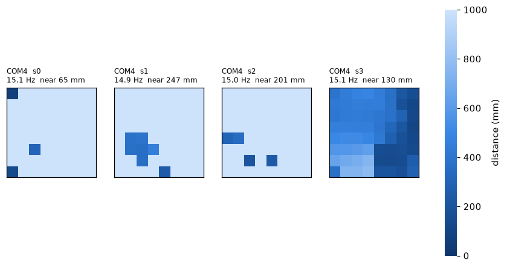
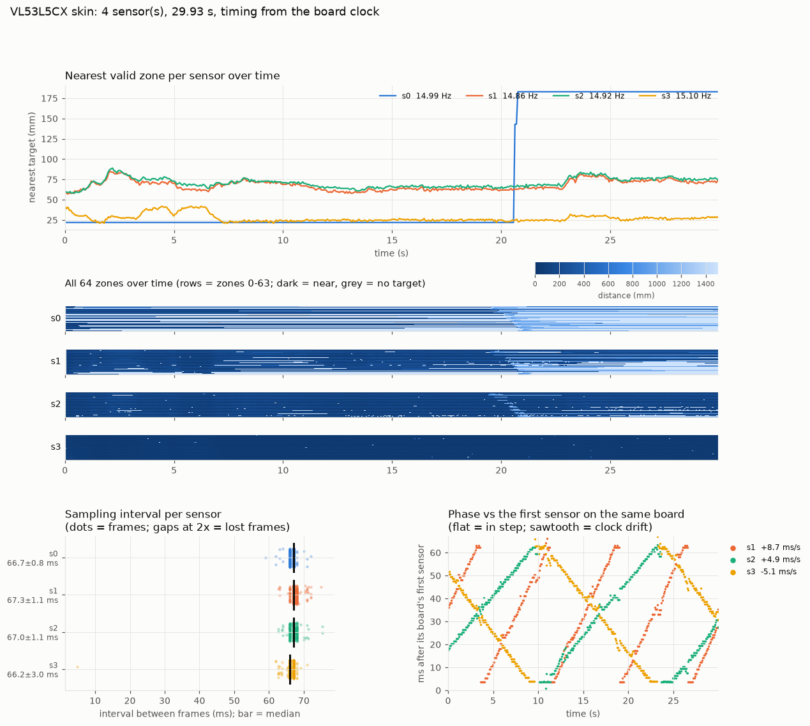
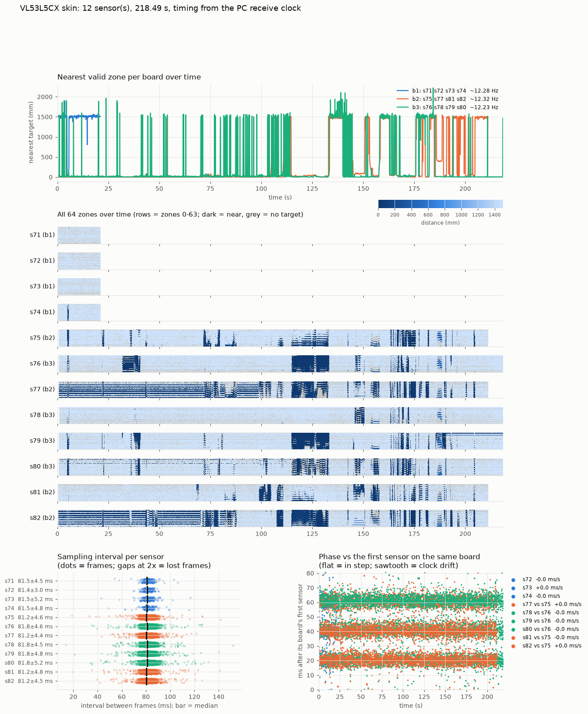

# VL53L5CX skin quickstart

Get VL53L5CX time-of-flight sensors on a robot skin streaming to your PC
and see them live.

```
VL53L5CX x N ──I2C──> mux (PCA9546A / TCA9548A) ──> ESP32-C6 ──Wi-Fi UDP──> PC: tools/tof.py
                                                            └──USB serial──┘ (bench / timing)
```



**Pointing an AI agent at this repo?** Send it to [`AGENTS.md`](AGENTS.md).
It has the same steps, each with a check that proves the step worked.

---

## 1. What you need

| Part | Notes |
|---|---|
| VL53L5CX breakouts | 8×8 zones, 45° field of view, up to ~4 m, up to 15 Hz. Each one sits at I2C address `0x29`. |
| I2C mux | PCA9546A (4 channels) or TCA9548A (8). It's needed because every sensor has the same address. Skip it for a single sensor. |
| ESP32-C6 board | e.g. a SparkFun Qwiic ESP32-C6. Other ESP32s work if you set the I2C pins. |
| 2.4 GHz Wi-Fi | The PC and the boards must be on the same network. |
| PC | Python 3.9+ with `numpy` and `matplotlib`. |

## 2. Wiring

```
ESP32-C6            mux (0x70)              sensors
 3V3 ───────────────  VIN ─────────────────  VIN   (every sensor)
 GND ───────────────  GND ─────────────────  GND   (every sensor)
 SDA (GPIO 6) ──────  SDA      SD0/SC0 ────  sensor 0 SDA/SCL
 SCL (GPIO 7) ──────  SCL      SD1/SC1 ────  sensor 1 SDA/SCL
                               SD2/SC2 ────  sensor 2 ...
```

- With Qwiic cables, plug them in and you're done. Qwiic carries 3.3 V, GND, SDA and SCL.
- Sensor *i* in the firmware is whatever is plugged into `SENSOR_MUX_PORT[i]`.
  That index is the ID in every packet.
- Long or daisy-chained cables: lower `I2C_HZ` to `400000`.

## 3. Flash the firmware

1. Install the **Arduino IDE** (or `arduino-cli`), the **esp32** core by
   Espressif (3.x), and the **SparkFun VL53L5CX Arduino Library** from the
   Library Manager.
2. Copy `firmware/skin_board/config.example.h` to `config.h` in the same folder.
   Set your Wi-Fi and the UDP port (one per board). `config.h` is git-ignored.
   By default the firmware **auto-detects** the I2C pins and every mux channel
   with a sensor on it (sensor *i* = the *i*-th channel found). Set
   `NUM_SENSORS`/`SENSOR_MUX_PORT` to fix the order yourself.
   - **No Wi-Fi handy?** Set `SEND_UDP 0` and `SEND_SERIAL 1`. Frames then go
     over the USB cable, and you read them with `tof.py --serial COM4`.
3. Board: **ESP32C6 Dev Module** (or your exact board) with **USB CDC On Boot:
   Enabled**. Without that, a native-USB board shows nothing on its serial
   port. Upload. With `arduino-cli`:

   ```bash
   arduino-cli core install esp32:esp32
   arduino-cli lib install "SparkFun VL53L5CX Arduino Library"
   arduino-cli compile --fqbn esp32:esp32:esp32c6:CDCOnBoot=cdc firmware/skin_board
   arduino-cli upload  --fqbn esp32:esp32:esp32c6:CDCOnBoot=cdc -p COM5 firmware/skin_board   # your port
   ```

4. Open the serial monitor at **115200**. A healthy boot looks like this:

   ```
   [wifi] ip=192.168.1.42 rssi=-51 dBm
   [udp] sending to 239.0.0.1:5005
   [i2c] sda=6 scl=7 1000000 Hz
   [scan] bus: 0x70
   [auto] 4 sensor(s)  s0=ch0  s1=ch1  s2=ch2  s3=ch3
   [scan] mux port 0: 0x29 0x70
   [sensor 0] ok
   ...
   [ready] 4/4 sensors running
   [rate Hz] s0=15.0 s1=14.8 s2=15.0 s3=15.0  read_ms avg=3.3 max=3.3  wifi=up
   ```

   Each sensor takes a few seconds to initialise: the library uploads ~90 KB of
   firmware to every VL53L5CX at boot.

## 4. See the data

```bash
pip install -r requirements.txt

python tools/tof.py status            # text: rate, nearest distance, % invalid zones per sensor
python tools/tof.py live              # fast live view (dark = near, grey = no target)
python tools/tof.py live --numbers    # with the mm value in each zone (n toggles, +/- colour range)
python tools/tof.py view              # the same in matplotlib, slower (and --save for a PNG)
python tools/tof.py record run1.npz --seconds 60
python tools/tof.py timing --seconds 20 --save timing.png   # data over time + sampling report

python tools/tof.py status --serial COM4   # any command, over the USB cable instead of Wi-Fi
```

By default it listens on ports **5004–5016**, multicast and unicast. Narrow
that with `--ports 5005`.

**No hardware yet?** Run a fake board, then `status` or `view` in a second
terminal:

```bash
python tools/tof.py fake --sensors 4 --port 5005
```

**Which viewer?** `live` draws with plain Tkinter (ships with Python) and
repaints only the cells that changed. On the test board it managed **~40
redraws/s with 1–3 ms lag**, numbers included. `view` uses matplotlib:
about 10 redraws/s and ~80 ms lag, and about 1 redraw/s with `--numbers`,
because matplotlib redraws every label each time. Use `view` when you want
`--save` snapshots.

## 5. Data over time and sampling rate

`tof.py timing` captures for a while (or reads a recording with `--from run1.npz`),
prints a per-sensor table, and with `--save` draws this:



- **Nearest valid zone over time**, one line per sensor.
- **All 64 zones over time**, one strip per sensor. Each row is a zone, so
  you can watch an object sweep across a sensor's field of view.
- **Sampling interval per sensor**: every frame-to-frame interval. Points at
  about 2× the median are lost frames.
- **Phase vs the first sensor over time**: when each sensor's frame lands,
  relative to sensor 0's. A flat line means the two are in step. A sawtooth
  means one sensor's clock runs fast or slow, and the slope is the drift.

What the numbers mean:

| Column | Meaning |
|---|---|
| `rate Hz` | Frames the sensor produced per second, from the board's frame counter (dropped packets don't lower it) |
| `interval ms`, `std`, `p99`, `max` | Time between frames on the **board clock**: the sensor's own sampling, with Wi-Fi/USB delay removed |
| `gaps`, `lost` | Intervals over 1.5× the median, and frames missing from the counter (lost in transport) |
| `phase ms` | When this sensor's frames land, relative to the first sensor's |
| `drift ms/s` | How fast that phase slides. Each VL53L5CX runs on its own oscillator, so sensors on one board are **not synchronised**, and their relative timing wanders |
| `PC jit p99` | Spread of transport delay (arrival time minus board time), the jitter Wi-Fi or USB adds |

Frames carry the board's microsecond clock and a per-sensor counter (the
last 6 bytes of the packet). Without them, as with older firmware, timing
falls back to PC receive time, which includes transport jitter.

### Measured on a real board (ESP32-C6, PCA9546A mux, 4 × VL53L5CX, 8×8 at 15 Hz, USB serial)

The figure above is that board: 30 s, 1,794 frames.

| | s0 | s1 | s2 | s3 |
|---|---|---|---|---|
| rate (Hz) | 14.99 | 14.86 | 14.92 | 15.10 |
| interval (ms) | 66.7 ± 0.9 | 67.3 ± 1.1 | 67.0 ± 1.1 | 66.2 ± 3.0 |
| drift vs s0 (ms/s) | | +8.7 | +4.9 | −5.1 |
| lost frames | 0 | 0 | 0 | 0 |

- **Every sensor has its own rate.** They spread over about 1.5% (14.86–15.10 Hz)
  and the spread repeats run to run, because each VL53L5CX runs on its own
  oscillator. Sensors on one board are **not synchronised**. Their relative
  phase slides through a full 67 ms cycle every 8–14 s. If you fuse sensors,
  timestamp each frame. Don't assume frames from one "round" were taken together.
- **The board can be the bottleneck.** By default the SparkFun library reads
  every output the sensor has (ambient, signal, sigma, reflectance, …), about
  19 ms per frame over I2C. The board reads its sensors one after another, so
  4 × 19 ms = 76 ms per round, which is more than the 66.7 ms frame period.
  Every sensor then fell to **about 13 Hz**, with frames skipped at random.
  `firmware/skin_board/build_opt.h` turns off the unused outputs. That cut
  the read to **3.3 ms** and brought all four sensors to **15 Hz**. The rule of
  thumb is sensors × `read_ms` (printed in the heartbeat) must stay under 66 ms.
- **Board timestamps are accurate to about one read slot.** A frame is
  timestamped when the board finds it ready. When two sensors become ready
  together, the second one waits for the first one's read, which shows as the
  flat stretches in the phase plot.
- **Transport jitter:** about 2 ms p99 over USB serial. Over Wi-Fi it's
  larger: measure it with `timing` (the `PC jit p99` column).

### HIRO recordings

`timing --from` also reads HIRO's `raw_data_*.npz` recordings and the `.npz`
files from `hiro_udp record`:

```bash
python tools/tof.py timing --from raw_data_20260819_141533.npz --save hiro.png
```

HIRO's firmware sends no board clock, so timing uses the PC receive time,
which includes Wi-Fi jitter. Its recorder also doesn't store which board a
frame came from. `timing` works that out from the data: HIRO's firmware reads
a board's sensors in a fixed loop, so sensors on one board stay locked
together, while separate boards drift apart. On the HIRO chest recordings this
recovers the three boards exactly (`71–74`, `75/77/81/82`, `76/78/79/80`).
Recordings under ~6 s are too short to tell. Name the boards yourself with
`--boards "71-74;75,77,81,82;76,78-80"`. Pauses over 1 s, such as Wi-Fi outages,
are left out of the rates.



**What all 11 HIRO recordings show:** every board runs at **about 12.3 Hz**
(4 sensors) or **10.5 Hz** (5 sensors), never 15. Sensors on a board land
about 20 ms apart, the same per-read time this repo's firmware measured before
`build_opt.h`. So 4 × 20 ms = 81 ms per round (12.3 Hz), and 5 × 19 ms = 95 ms
(10.5 Hz). The skins are limited by the board's I2C reads, not by the sensors.
Turning off the unused outputs, as `build_opt.h` does, would bring them to 15 Hz.

## 6. Use it in your own code

[`examples/minimal_receiver.py`](examples/minimal_receiver.py) is about 20 lines
and needs only numpy. Or import the helpers:

```python
import sys; sys.path.insert(0, 'path/to/vl53l5cx-skin-quickstart/tools')
from tof import parse_packet, zone_rays
sensor, mm, raw = parse_packet(datagram)       # mm: (64,) uint16, 0 = no target
points_m = zone_rays() * (mm[:, None] / 1000)  # (64, 3) in the sensor frame, z out of the sensor
```

### Wire format

One UDP datagram per sensor frame, little-endian, 263 bytes:

| Bytes | Content |
|---|---|
| 0 | sensor index (0…N−1 on that board) |
| 1–128 | 64 × `uint16` filtered distance, mm. **4000 = no target** (the sensor's `target_status == 255`). |
| 129–256 | 64 × `uint16` raw distance, mm, unfiltered |
| 257–260 | `uint32` board time in µs when the frame was read (wraps every ~71 min) |
| 261–262 | `uint16` per-sensor frame counter (gaps = lost frames) |

Over USB serial, each packet is wrapped as `[0xA5 0x5A][uint16 length][packet]`,
mixed in with plain-text log lines.

- Zone *k* is row `k // 8`, column `k % 8`. Check which way is "up" on your
  mounting by waving a hand across the sensor.
- Bytes 0–256 are the classic HIRO format, and readers that stop there keep
  working. Older firmware sends 257 or 129 bytes. `tof.py` accepts all three.
- Boards are told apart by **port**, sensors by the **index byte**.

### `record` output (`.npz`)

| Array | Shape | Meaning |
|---|---|---|
| `timestamps` | (N,) uint64 | receive time, ns since epoch |
| `ports`, `sensor_ids` | (N,) | which board, which sensor |
| `readings_mm` | (N, 64) uint16 | filtered mm, 0 = no target |
| `raw_mm` | (N, 64) uint16 | raw mm (zeros if the board sends short packets) |
| `sources` | (N,) str | sender IP (or serial port) |
| `board_us`, `seq`, `has_meta` | (N,) | board clock, frame counter, whether the packet carried them |

## 7. Troubleshooting

| Symptom | Fix |
|---|---|
| Nothing at all on the serial monitor (native-USB board) | Rebuild with **USB CDC On Boot: Enabled** (`:CDCOnBoot=cdc` in the FQBN). |
| Serial: `no mux at 0x70` / `[scan] bus: (none)` | Wrong pins: check `I2C_SDA`/`I2C_SCL` (Qwiic C6: 6/7; generic C6: 23/22). Check power and cables. If an address jumper is set, the mux sits at 0x71–0x77. |
| Serial: `sensor N: no VL53L5CX at 0x29` | Look at that line's `[scan] mux port P:`. With no `0x29` there, the cable or the mux channel is wrong. |
| Serial stops at `[wifi] connecting...` | The network must be 2.4 GHz. Check the SSID and password. |
| `tof.py status`: "no frames yet" while the board says `[ready]` | (1) The PC is on a different network or a guest Wi-Fi that isolates clients. (2) The **Windows firewall** blocks inbound UDP. Allow it once from an admin shell: `netsh advfirewall firewall add rule name="tof skin" dir=in action=allow protocol=UDP localport=5004-5016`. (3) Multicast is blocked: pass `--iface <your PC's IP>`, or set `DEST_IP` in `config.h` to your PC's IP (unicast). |
| `[warn] port ...: Address already in use` | Another receiver holds the port. Close it. |
| Rate well below 15 Hz | Check `tof.py timing` and the heartbeat's `read_ms`. If sensors × `read_ms` is over ~66 ms, the board can't keep up: make sure `build_opt.h` sits next to the sketch, or lower `I2C_HZ` only if you must. Many `lost` means weak Wi-Fi (RSSI below −75 dBm). |
| Can't receive on this network (guest Wi-Fi, no firewall rights) | Use `SEND_SERIAL 1` and `--serial <port>` for bench work. |
| Some zones always read 1–60 mm | The skin's shell is in that zone's view. Mask them in your code. |
| Many zones invalid (grey) | Normal past ~2–4 m, on dark or angled surfaces, and in sunlight. |

## Layout

```
firmware/skin_board/   ESP32 sketch, config.example.h, build_opt.h (slims sensor reads)
tools/tof.py           status / view / record / fake (single file)
examples/              minimal receiver
tests/                 python tests/test_tof.py  (no hardware needed)
AGENTS.md              step-by-step setup for AI agents
```

The wire format matches the firmware used on HIRO Lab's proximity skins, so
existing recordings and tools that expect it will work.
